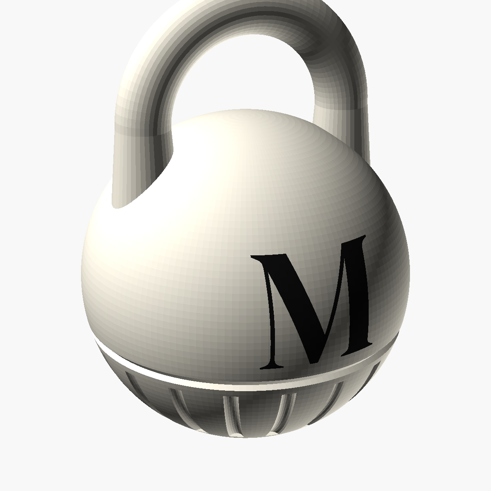
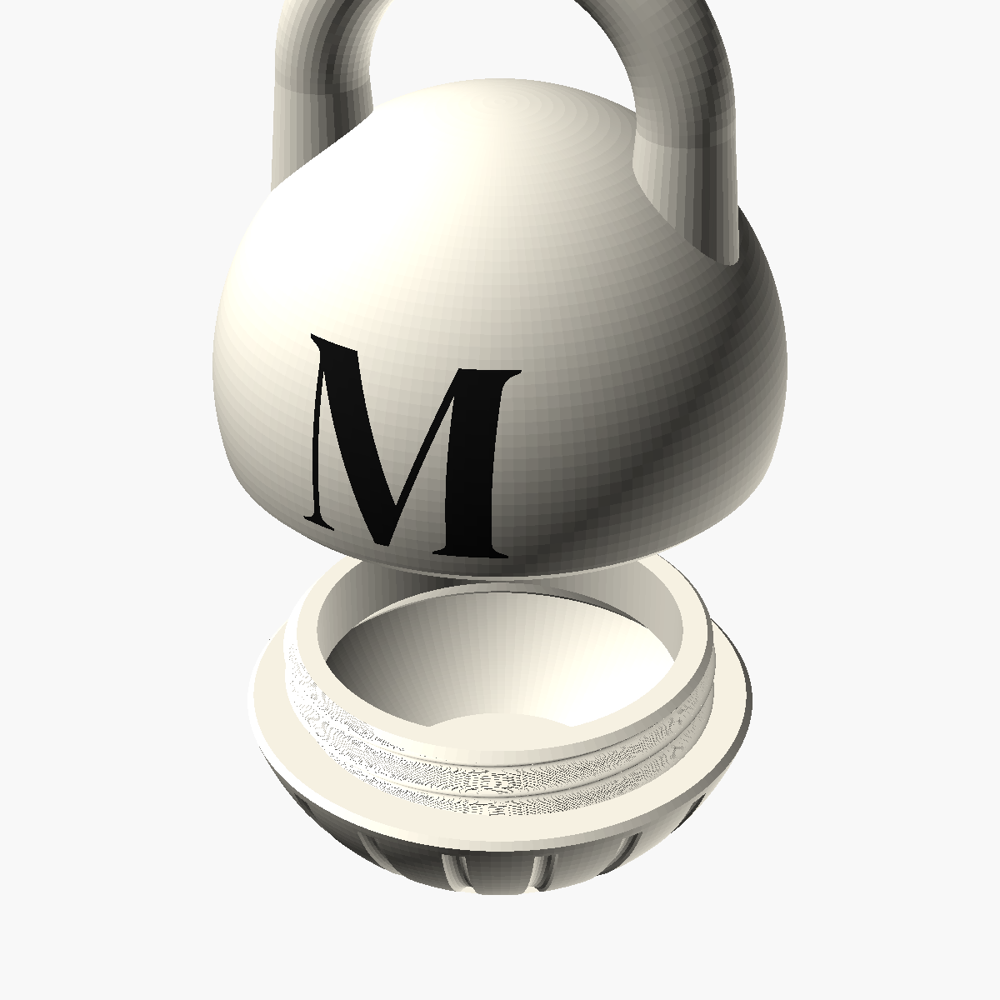

# Kettlebell Jewelry Keeper — "M" edition

A screw-top kettlebell keychain to keep your rings and earrings safe while you train.
Clip it to your gym bag, drop your jewelry in, and twist it shut.

## What's better than the original
| | Original | This version |
|---|---|---|
| Closing | push / friction fit | **real screw thread**: about 2 turns, right-hand (twist right to close), so it won't pop open in a bag |
| Standing | rolls over | **flat base**, so it stands on a bench or nightstand |
| Grip | smooth | **18 fluted grip ribs** on the cup, which are easier to twist with sweaty hands and look like a jewelry box |
| Seam | visible split line | the split becomes a **V-groove accent line** |
| Branding | "GYM" | a large serif **M** in black (font: DM Serif Display) |
| Inside | — | 30 mm opening and a smooth rounded floor, so small studs don't get stuck in corners |

Size: about 44 mm wide and 64 mm tall closed, roughly the same as the original keychain.

## Files
| File | Colour | Notes |
|---|---|---|
| `stl/kettlebell_top.stl` | white / cream | handle side; the M is recessed 1 mm |
| `stl/kettlebell_cup.stl` | white / cream | the base cup |
| `stl/kettlebell_inlay.stl` | **black** | the M; fills the recess exactly |
| `kettlebell_keeper.scad` | — | editable OpenSCAD source (letter, font, size, thread fit) |

## Printing
- **Filament:** PLA or PETG. For the body, "Ivory White", "Bone White" or a warm cream; black for the M.
- **Settings:** 0.2 mm layers (0.12 mm for a smoother finish), 3 walls, 15 % infill, **no supports**. Every overhang is 45° or less.
- **Orientation:** as exported. Top: seam face down, handle up. Cup: base down.
- **Black M on a multi-colour printer (Bambu AMS, Prusa MMU and similar):** import `kettlebell_top.stl` and `kettlebell_inlay.stl` together. When asked, choose "load as a single object with multiple parts". They share a coordinate system, so the M drops into place. Assign black to the inlay.
- **Single-colour printer:** print the top in white, then fill the recessed M with black acrylic paint or a paint marker and wipe off the excess. Or print the inlay separately in black and glue it in with a drop of CA glue.
- **Keychain:** thread a ball chain or split ring through the handle.

## Adjusting it
Open `kettlebell_keeper.scad` in OpenSCAD, which is free:
- Change `letter` to any initial. To use another font, change `font` and the `use <...ttf>` line.
- If the thread is too tight on your printer, raise `clearance` from 0.35 to 0.45. If it's too loose, lower it to 0.25.
- Export a part with `openscad -o top.stl -D 'PART="top"' kettlebell_keeper.scad` (also `"cup"` and `"inlay"`).

The parts were checked in software. All three are watertight single solids, the thread unscrews through 2 full turns with no collision, and the halves sit flush on the shoulder when closed.

Font: DM Serif Display, SIL Open Font License (see `fonts/OFL.txt`).
